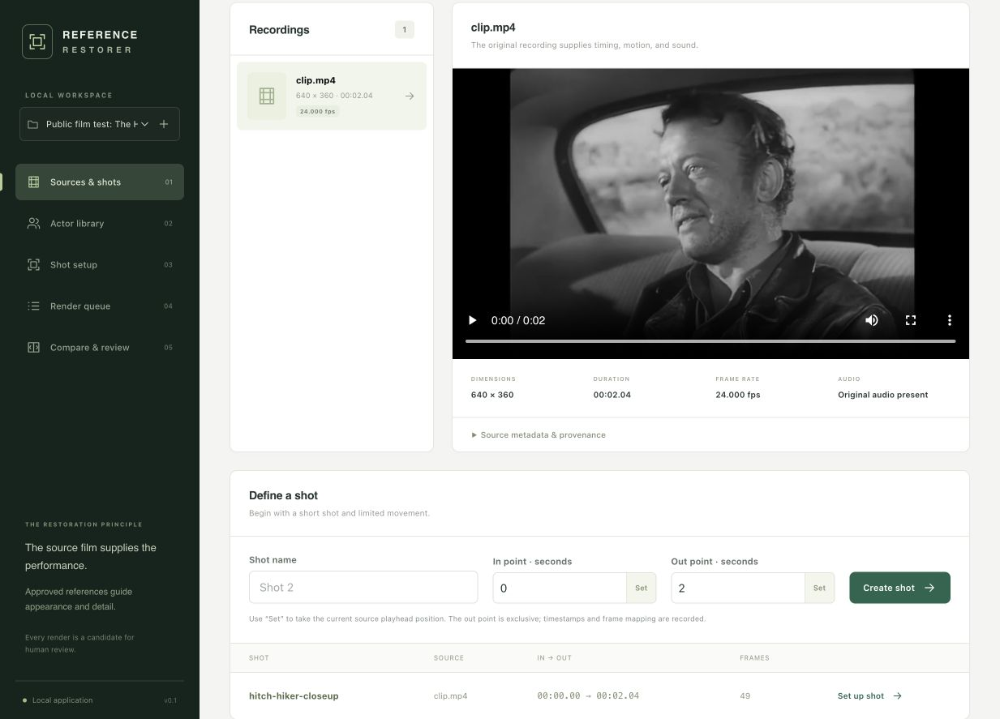
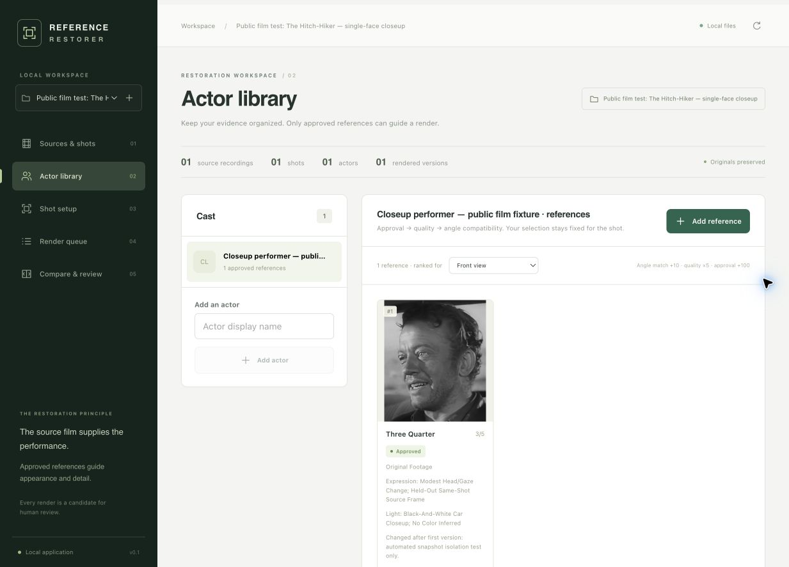
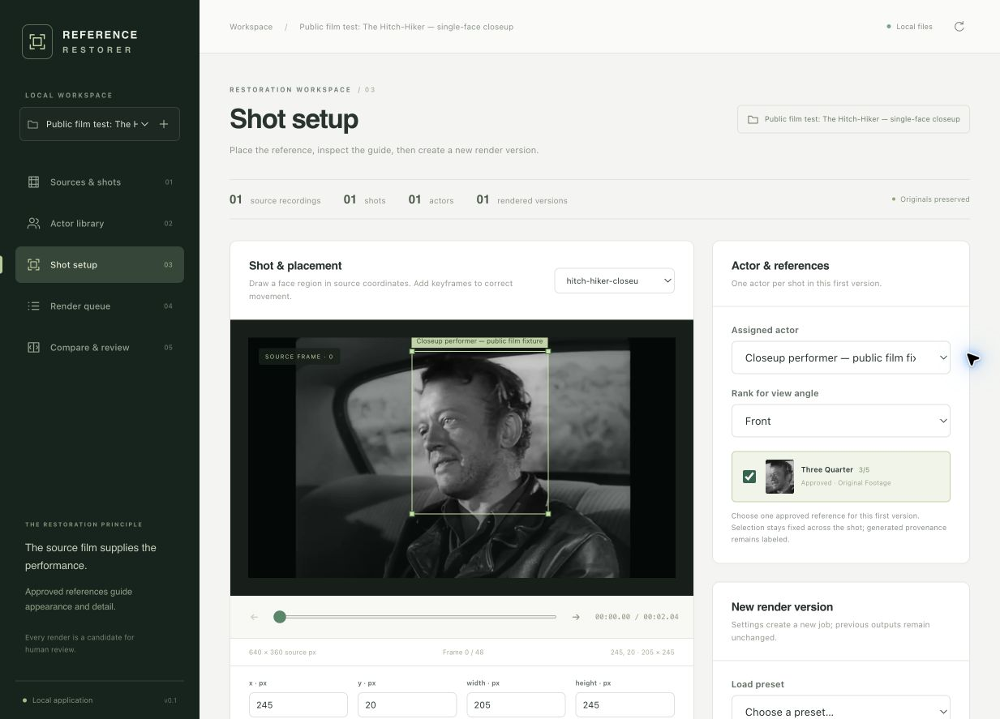
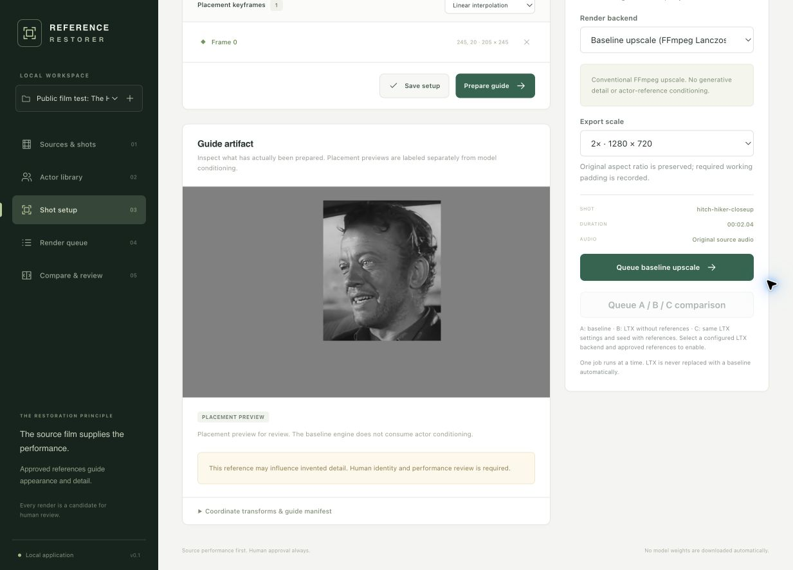
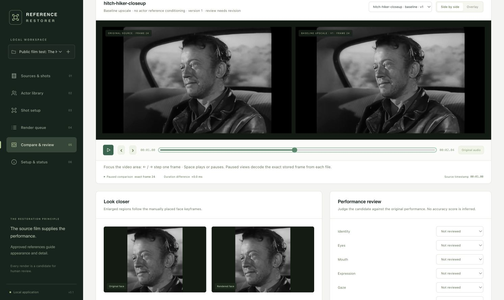
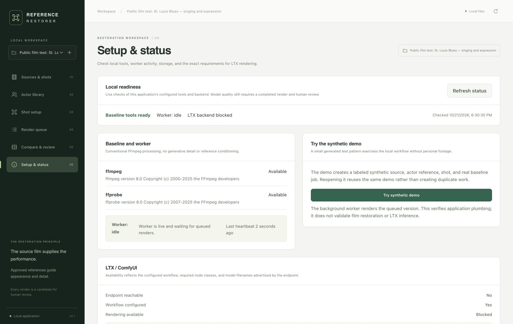
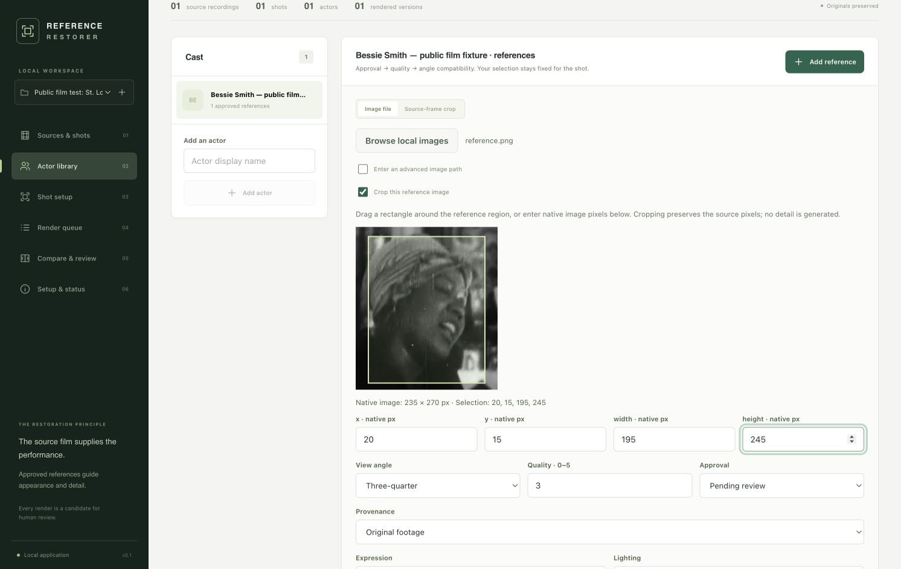

# LTX Reference Restorer

A local film-restoration workspace for source clips, actor references, shot guides, versioned render jobs and human comparison. **Preview:** the conventional workflow is tested; actual LTX model inference remains unverified.

**The source film supplies the performance. Approved references guide appearance and detail.** This is a review criterion, not a guarantee from a generative model.

The complete conventional workflow runs with FFmpeg and no model weights. Its output is labeled **baseline upscale**. LTX jobs use an existing, explicitly configured ComfyUI installation and a compatible API-format workflow; they never silently fall back to the baseline. Native MLX restoration/reference rendering is explicitly unavailable in this version. See [integration notes](docs/integration-notes.md) for inspected upstream code, limitations and verification status.

## Setup and launch

Install Python 3.11–3.14, [uv](https://docs.astral.sh/uv/), Node.js 22+ and FFmpeg/ffprobe. On macOS with Homebrew, `brew install uv node ffmpeg` supplies the tools; uv selects a compatible Python. From the source checkout:

```sh
./scripts/launch.sh
```

On macOS you can also double-click **Launch Restorer.command**. The launcher checks prerequisites, syncs the committed Python lock, installs/builds the frontend, then runs the API and separate worker. It does not install system tools, download model weights or start ComfyUI. Open **http://127.0.0.1:8787**; Ctrl-C in the launch terminal stops both owned processes.

Open **Setup & status** to inspect FFmpeg/ffprobe, worker heartbeat, data storage and precise configured LTX blockers. **Try synthetic demo** creates a labeled example project and queues a real baseline; reopening it reuses the demo. **Download safe diagnostics** provides an allowlisted report without project contents, local paths, endpoint URLs or raw logs.

See the [first-use guide](docs/setup.md) for manual setup, configuration, isolated demos, backups and troubleshooting. The exercised desktop is macOS arm64; Ubuntu CI checks automated Python/FFmpeg and frontend behavior. Native Windows is unsupported by the current POSIX worker implementation. Other desktop combinations require local verification; dependency version ranges are not a test matrix.

The current default data directory is `~/Library/Application Support/LTX Reference Restorer`. Set `RESTORER_DATA_DIR=/absolute/path` for a different location, especially on Linux. Copy [config.example.toml](config.example.toml) to an untracked local file and select it with `RESTORER_CONFIG=/absolute/path/config.local.toml`; restrict `import_roots` to intended media folders. The [setup guide](docs/setup.md#local-data-and-import-scope) lists environment overrides.

## Daily workflow

1. Create or reopen a project. Use **Browse local videos** to select source recordings within configured import folders; an advanced local-path field is also available. The app copies them into its data directory and records hashes and ffprobe metadata.
2. Choose the source for a shot and enter start/end times. Inspect preview frames and timing, field order, frame rate and aspect ratio before rendering.
3. Add an actor. Use **Browse local images** to choose a reference, or select a source frame. Draw the crop visually or enter its native pixel coordinates. Record view, quality, approval, expression, lighting and provenance. Approve references deliberately; generated reconstructions remain labeled generated.
4. Assign one actor and an approved reference to the shot. Draw a face region on the preview, add placement keyframes if needed and inspect the actual guide artifact. The native-resolution reference crop is centered on that region in a gray working canvas; it is not resized or warped to fill the box. An oversized crop is rejected. Model conditioning initially requires a fixed region; unsupported movement is rejected with an explanation. Unsaved actor/reference/placement changes are marked and guarded before leaving the setup.
5. Queue a baseline upscale, or a preflight-approved LTX Restore/Refine job. Each job snapshots inputs and settings, uses its own output directory and shows errors and logs. Retry creates a new version.
6. Compare original and output side by side or in overlay, with enlarged face regions and selected references. While paused, the app displays exact server-decoded source/output PNG frames from the completed job's frozen frame mapping; stepping changes that frame pair. Loading or decoding/verification failure is shown explicitly. Play uses synchronized browser video playback; pause returns to the decoded stills. Inspect technical timing separately from identity, eyes, mouth, expression, gaze, motion, flicker and invented detail. Accept, Reject or mark Needs Revision and add notes.
7. Reopen the project later. Sources, reference approvals, immutable results and review state persist in SQLite and the data directory.

## Screenshots

Real captures of the running app using *The Hitch-Hiker* and *St. Louis Blues* from the [public film test kit](docs/public-film-demo.md). Film images come from the Library of Congress YouTube editions of [The Hitch-Hiker](https://www.youtube.com/watch?v=VcKZ636kvxg) and [St. Louis Blues](https://www.youtube.com/watch?v=hdoRQ2iqh8I); see the [source catalog](fixtures/public-films/catalog.json) for attribution and rights scope.

These examples show an **FFmpeg baseline upscale** and a **reference placement preview**. LTX inference remains unverified. Reference approval and the Needs Revision label are automated fixture setup/persistence states; human identity and performance review has not been performed.

**1. Inspect a source and define a shot.** Review the clip's dimensions, frame rate, supplied audio and in/out range. This public fixture contains 49 frames.



**2. Organize actor references.** Keep authentic source crops with their view angle, expression, lighting and approval state.



**3. Place the selected reference.** Inspect the face region in source coordinates and assign an approved reference to the shot.



**4. Inspect the prepared guide.** The actual placement preview is displayed with the selected render settings. The baseline engine does not consume actor conditioning.



**5. Compare the completed version.** Use synchronized video playback, pause or step to inspect exact decoded source/output stills, then record a human review. The capture below shows the comparison layout; paused stills use the same panels.



**Check local readiness.** Setup & status checks tools and worker activity while clearly reporting the configured LTX blockers.



**Crop a reference visually.** Select authentic source pixels with a rectangle or native image coordinates. The public *St. Louis Blues* reference below is pending review; the form was canceled after capture.



## Reproducible synthetic demo

For real historical footage, see the [public film test kit](docs/public-film-demo.md) and its [executed results](docs/public-film-results.md). It downloads official Library of Congress YouTube editions, prepares three timestamp-mapped 49-frame clips and held-out actor references, and exercises the wrapper with shareable reports. Downloads are opt-in and remain outside Git.

```sh
RESTORER_DATA_DIR="$PWD/.data/demo" uv run restorer demo
RESTORER_DATA_DIR="$PWD/.data/demo" uv run restorer start
```

These commands use a separate ignored demo data directory. The demo creates synthetic media and a synthetic actor reference locally, imports them, defines a two-second shot, assigns the reference, prepares a guide and runs a real FFmpeg baseline render. It uses no private footage, actor photograph, downloaded fixture or model weights. Run the demo with that directory's app/worker stopped so it can acquire the single-worker lock. Open its project in the browser, compare the unreviewed result and record your decision, then restart and reopen it using the same data directory. Demo-generated art is labeled generated evidence. Automated baseline coverage exercises real FFmpeg processing; approval in that test is a persistence check, not human visual endorsement. The demo command deliberately leaves the output unreviewed.

For controlled A/B/C evaluation use the same shot: **A** baseline upscale; **B** LTX without actor references; **C** the same LTX configuration and seed with references. The ComfyUI workflow must expose the real reference toggle/binding; use the controlled comparison action to preserve the common settings. Unsupported reference configurations are refused. A baseline is not B or C. No LTX render is reported successful until an actual backend output passes technical checks.

First-version limits are explicit: each imported source contains at most 20,000 decoded frames; model jobs require progressive constant-frame-rate shots with 2–97 source frames, padded to 9–97 frames on the `8n+1` grid. The working canvas is padded to multiples of 32, up to 4096 pixels on either axis, and cropped back on export. One actor and one approved reference enter a conditioning guide. The library can hold additional references. The inspected upstream distilled recipe uses eight steps; arbitrary sampling controls are rejected. The first source audio stream is retained by content, with AAC encoding for the prepared/baseline clip; this is not a bit-identical audio archive. Original imported files remain intact.

Videos with display-rotation metadata are rejected in this version so previews, face coordinates and export geometry cannot silently disagree. Prepare a separately documented, correctly oriented derivative and import it; retain the original recording.

Baseline upscaling preserves known interlaced field order using field-aware scaling and interlaced encoding. Unknown field order or an output height that cannot be encoded without padding is rejected. LTX requires a separately prepared progressive derivative and never deinterlaces automatically.

## ComfyUI and Apple Silicon

Shot setup includes named presets that populate real job settings without submitting a render. Customize `[restorer.presets.<name>]` in your local TOML configuration; the example provides a 2× baseline and a short 1× LTX probe with eight steps and seed 42. These presets do not infer hardware support from RAM capacity.

Set `comfy_url` and `comfy_workflow` for an existing installation. Use the documented workflow bundle contract and install its exact nodes and matching 2.5 model/adapter files yourself. Doctor checks connectivity, discovered node names, advertised model filenames and configured workflow requirements; discovery does not prove model loading or inference. [Integration notes](docs/integration-notes.md) explain source-video conditioning, reference semantics, padding, frame counts, tiling and streaming restrictions.

Start with one actor, a fixed face placement, about two seconds and a 2× baseline. An M1 Max with 32 GB, a 36 GB Mac Studio and an M5 Max with 128 GB can organize media and prepare guides without LTX weights. Memory capacity does not establish model compatibility, speed or fidelity. Doctor reports available RAM/disk and package versions; render records store observed memory/runtime where measurable. MLX's image anchors are not an interchangeable actor-reference backend.

Model downloads are explicit and user initiated outside this application. Review each model's license and any access gate on its model page, and accept required terms using your own account. Do not put tokens, downloaded model weights or gated assets in this repository. The application does not grant model licenses or bundle credentials.

## Checks and troubleshooting

```sh
uv sync --locked --extra dev --extra public-demo
uv run pytest -q
cd frontend
npm ci
npm run build
npx playwright install chromium webkit
npm run test:e2e
```

Current local validation passed **124 Python tests**, the strict TypeScript/Vite production build and **6 browser cases across Chromium and WebKit**, including actual decoded PNG frame pairs, face-crop pixels, loading/failure/retry and replay after the final frame. The [verification summary](docs/verification.md) records exact revision/platform scope, with [CI results attached to each pushed commit](https://github.com/jdj333/ltx-reference-restorer/actions). Three 49-frame public-film baselines passed again; see the [fresh safe report](fixtures/public-films/results/2026-10-21-polish.json). Browser and transport tests do not establish model inference or human identity/performance approval. The [LTX pilot procedure](docs/ltx-pilot.md) defines the remaining real B/C experiment and evidence.

- **FFmpeg missing:** install FFmpeg including ffprobe, or configure their executable paths, then rerun `restorer doctor`.
- **Import denied:** add the resolved source directory to `import_roots` in your local config. Imports are scoped; asset URLs do not expose arbitrary filesystem paths.
- **Browser interface missing:** run `npm ci && npm run build` inside `frontend` before starting the Python server.
- **Port 8787 already in use:** launch with `RESTORER_PORT=8790 uv run restorer start`, then open `http://127.0.0.1:8790`.
- **Jobs stay queued:** ensure the worker is running. A second worker is rejected while the first holds the data directory's worker lock.
- **Interrupted job:** the worker records abandoned running jobs as interrupted. Use retry to create a new output version; partial rendering is not resumed.
- **ComfyUI unavailable/missing nodes/models:** inspect doctor and job errors, check the configured address and workflow, and install the exact required components in ComfyUI. Model filenames shown by discovery are not a hardware inference test.
- **ComfyUI cancellation still running remotely:** older servers may lack prompt-specific running cancellation. The local job records the unconfirmed remote state; stop that prompt in ComfyUI or wait for it to finish. New renders/retries are blocked while that earlier application-owned prompt remains active. The app never interrupts unrelated prompts globally.
- **VFR, geometry or reference rejection:** inspect the reported constraint and choose a supported short shot/workflow. The app does not silently alter playback speed, invent a supported capability or substitute a baseline render.

Keep the server on localhost. It is a trusted-user local application without network-service authentication. Back up the entire data directory, including SQLite and media, while processes are stopped. Source media, generated outputs, local databases, caches, models and secrets stay outside Git. See [architecture](docs/architecture.md) and [roadmap](docs/roadmap.md).

For development and safe public bug reports, see [CONTRIBUTING.md](CONTRIBUTING.md). [CHANGELOG.md](CHANGELOG.md) and the [preview notes](docs/releases/0.1.0-preview.md) describe the preview scope; [verification](docs/verification.md) records executed evidence and remaining inference limits.

## License

The application code and original documentation use the [MIT License](LICENSE), copyright © 2026 jdj333. Model weights, upstream software, films and other third-party assets retain their own terms; the MIT code license does not grant model access or additional media rights. See the [public-film source catalog](fixtures/public-films/catalog.json) and [model integration notes](docs/integration-notes.md).
